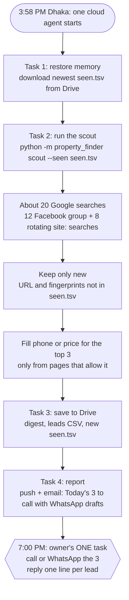

# MRA Property Scout — Lean Daily Pipeline
Process documentation — copy into any new session for context

## WHAT THIS IS
One cloud agent, once a day, runs about 20 targeted Google searches for property for sale in Gulshan,
Banani, Purbachal, Uttara, Dhanmondi and Bashundhara R/A, keeps only listings it has never seen before,
and emails the owner. The owner does one task a day.

No site is crawled. Listings come from Google's own title and snippet, through the Serper API, so sites
that block crawlers (Bproperty, Bikroy, Bdstall, Facebook) are still covered.

## THE SEARCHES (property_finder/scout.json, edit freely)
Every day, for each of the 6 areas (12 searches, past week only, so results are fresh):
* `site:facebook.com/groups "Gulshan" flat sale`
* `site:facebook.com/groups গুলশান ফ্ল্যাট OR প্লট বিক্রি`

Plus 8 from a rotating pool, a different slice each day (about 260 combinations, so it takes about a month
to repeat):
* `site:bproperty.com/property "Gulshan" duplex sale`
* `site:bikroy.com "Banani" used flat sale`
* `site:bdhousing.com/details "Purbachal" plot sale`
* `site:bdstall.com "Dhanmondi" ready flat sale`
* `site:facebook.com/groups "Gulshan" "10 katha"` (3, 5, 10, 20 katha; past month)
* `site:facebook.com/marketplace "Uttara" apartment for sale` (past month)
* `site:facebook.com "Bashundhara" flat sale sqft` (Facebook pages; past week)
* `"Purbachal" "5 katha" plot sale -site:facebook.com` (open web; past month)

## NO REPEATS
`seen.tsv` in Google Drive is the only memory: short hashes of every listing found in the last 14 days (about
30 KB, so it is cheap to carry each day). A result is new only if neither its URL nor any fingerprint is in it:
* phone + area + size
* area + size + price
* the first 120 letters of the post text (catches the same ad reposted in many Facebook groups)

Results that are not one property are dropped: category pages, whole groups, "wanted" posts, YouTube,
Pakistan/India sites (Gulshan-e-Iqbal, Kolkata's Purbachal), and anything outside the six areas. Odd or
hidden prices and sizes are kept and marked "Clear with seller", because sellers hide them on purpose.

## THE DAY: one agent, four tasks

Owner, 7 PM, about 20 minutes: open the email, contact the 3, reply with one line per lead
(called / no answer / interested / not interested / sold).

## COST
About 20 Serper searches a day, about 600 a month: the free 2,500 lasts about 4 months, then Serper's
paid plan. Change `extra_per_day` in scout.json to spend more or less.

## DRIVE (folder "MRA Property Scout")
* `seen-YYYY-MM-DD.tsv`: the memory (the newest one is read each day; older ones can be deleted after a week)
* `leads-YYYY-MM-DD.csv`: that day's new listings only
* `MRA Property Scout YYYY-MM-DD`: that day's digest (Google Doc)

## RUN BY HAND
`SERPER_API_KEY=... python3 -m property_finder scout --seen seen.tsv --out out`
(add `--master master.csv` to also keep a full history). Copy `out/seen.tsv` over `seen.tsv` for tomorrow.

The full dashboard (`python -m property_finder`) stays in the repo for deeper research on the owner's own
computer. The daily process uses only `scout`.
